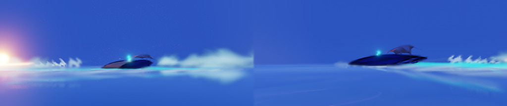

# Devlog #002: Style, Concept and World

**Date:** October 18, 2026  

  

*Style and Concept:*

Aero-Aesthetic / Frutiger Aero (Sci-Fi) style.
An abundance of clear blue sky, glossy surfaces, and clouds.
A sense of a high-tech yet eco-friendly, "bright" future (Solarpunk/Eco-futurism).
Sky-blue tones, neon-turquoise light emanating from spacecraft, and lush, vibrant greenery—a futuristic "Aero" aesthetic.

*World Description:*

A new exoplanet has become accessible—a tranquil, airy ocean where gravity behaves anomalously and the horizon glows, even in total darkness.

Following the installation of a network of beacons, construction has begun on industrial zones surrounding them. These beacons are complex devices that project a stable gravitational field; it is this field that captures dust and gas particles, gradually forming an environment suitable for life.
